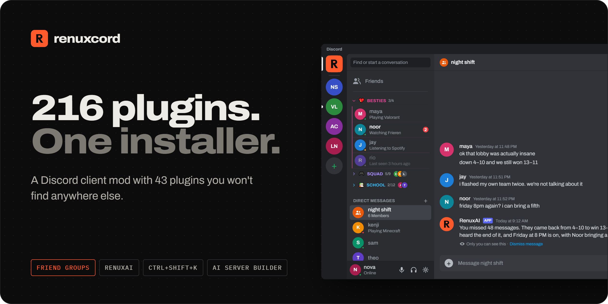
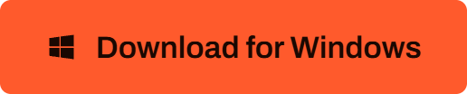
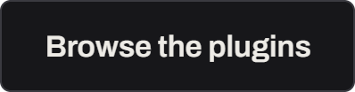
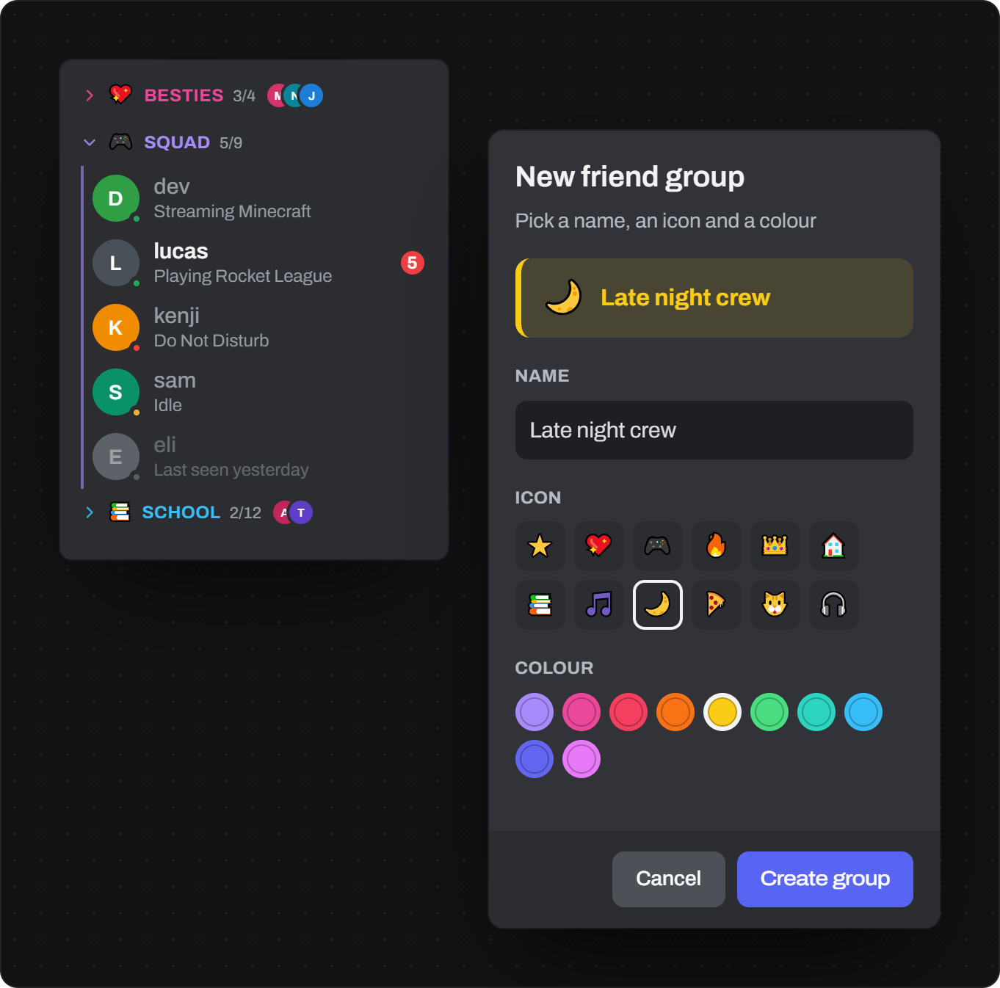
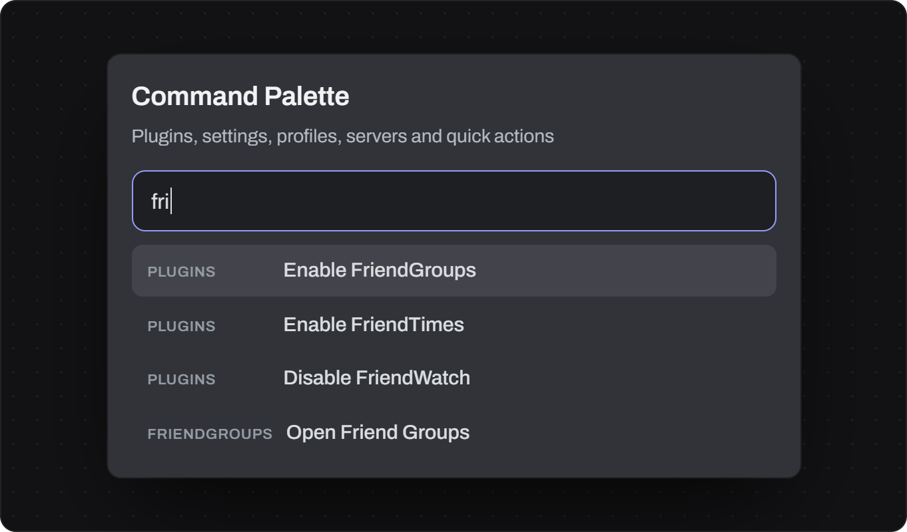
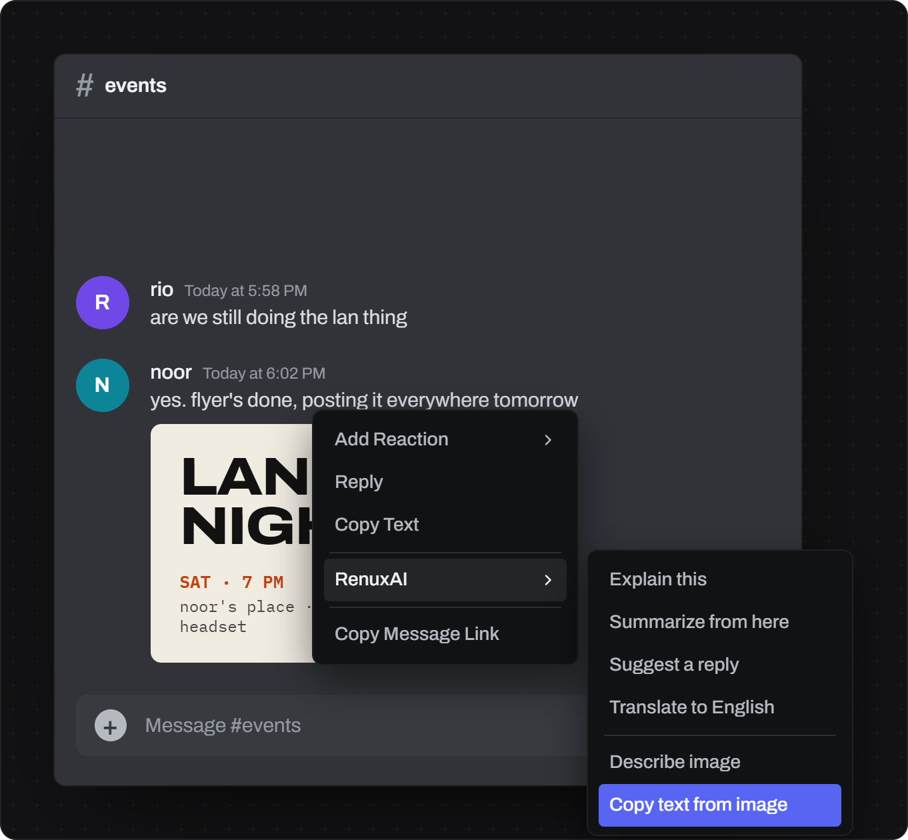
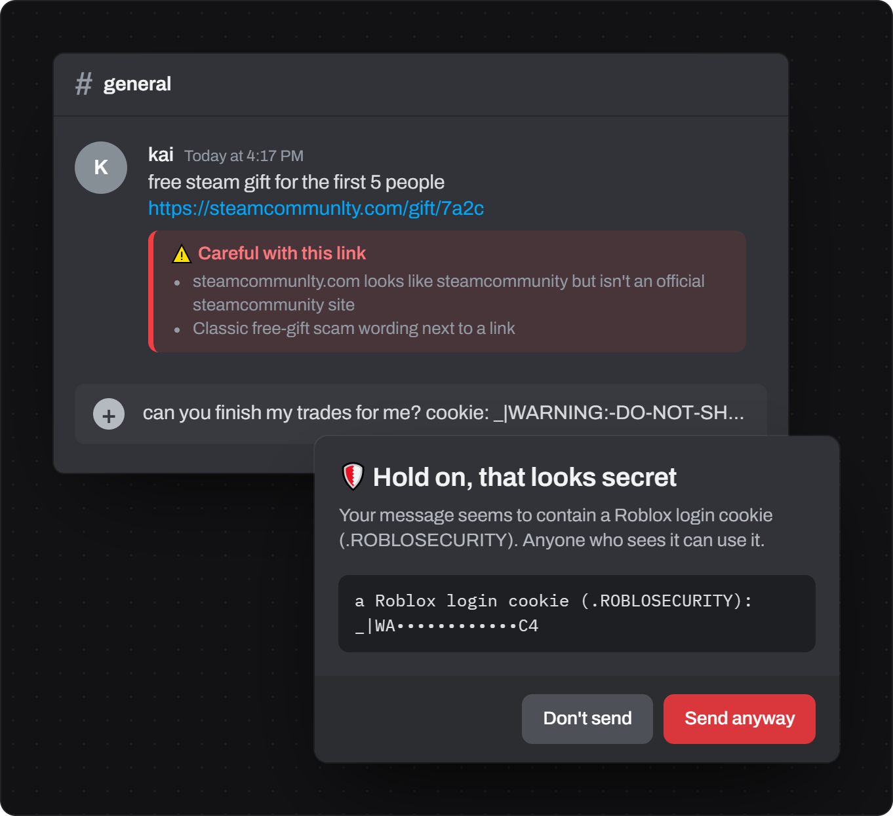
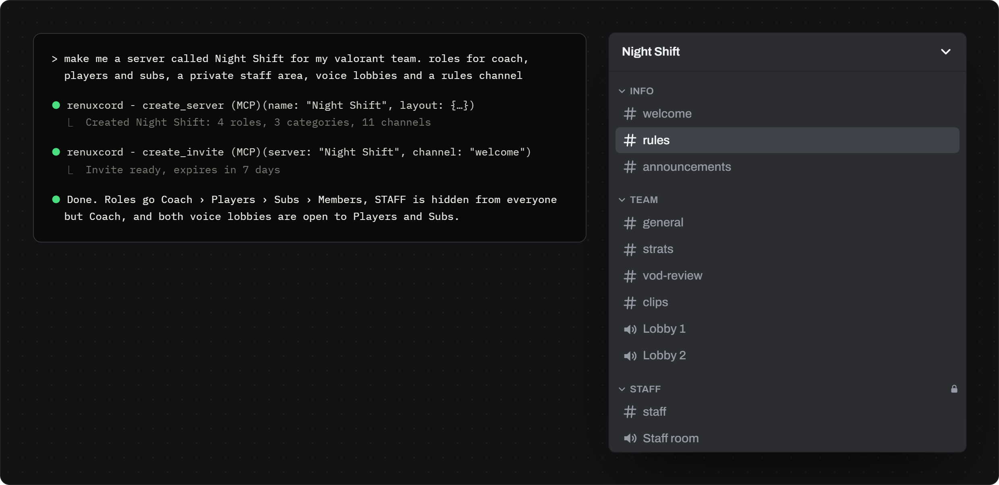

<div align="center">

<a href="https://renuxchan.github.io/Renuxcord/"></a>

<br>
<br>

<a href="https://github.com/Renuxchan/Renuxcord/releases/latest/download/RenuxcordInstaller.exe"></a>
&nbsp;
<a href="https://renuxchan.github.io/Renuxcord/"></a>
&nbsp;
<a href="https://renuxchan.github.io/Renuxcord/#plugins"></a>

<br>
<br>

<a href="https://github.com/Renuxchan/Renuxcord/actions/workflows/renuxcord-release.yml"></a>
<a href="https://github.com/Renuxchan/Renuxcord/commits/main"></a>


<a href="../LICENSE"></a>

<br>
<br>

**Renuxcord is a client mod for the Discord desktop app.**<br>
Every plugin you'd expect from a client mod, plus 43 you won't find anywhere else: friend folders in your DM sidebar,<br>
Claude in your chat, a command palette, and a bridge that lets Claude Code build your servers. Free, open source, and it keeps itself updated.

</div>

<br>

<table>
  <tr>
    <td width="50%" valign="top">
      
      <h3>Friend Groups</h3>
      Friend folders right in your DM sidebar, each with an emoji, a colour and an online count. Fold them, drag people between them, and click anyone to open your DM.
    </td>
    <td width="50%" valign="top">
      
      <h3>Command palette</h3>
      <kbd>Ctrl</kbd> <kbd>Shift</kbd> <kbd>K</kbd> turns any plugin on or off, switches plugin profiles, and jumps to any server, channel or DM. No digging through settings.
    </td>
  </tr>
  <tr>
    <td width="50%" valign="top">
      
      <h3>RenuxAI</h3>
      Claude in your chat. <code>/ai catchup</code> sums up what you missed, and the right-click menu explains, translates, suggests replies and reads images. It runs on your Claude Code login, so no API key needed.
    </td>
    <td width="50%" valign="top">
      
      <h3>LinkSafety and SecretGuard</h3>
      Warnings under fake Discord, Steam and Roblox links, and a "you sure?" before you send your token, a Roblox cookie, an API key or a card number.
    </td>
  </tr>
</table>

## Let Claude Code build your servers



**RenuxBridge** hooks your Discord up to Claude Code over MCP. Describe the server you want and it gets built: roles in the right order, private categories, voice lobbies, permissions and all.

1. Turn on **RenuxBridge** in Settings › Renuxcord › Plugins.
2. Press **Copy command** in its settings and run it once in a terminal. It looks like this:

   ```sh
   claude mcp add renuxcord --scope user -- node "%APPDATA%\Renuxcord\dist\renuxcord-mcp.mjs"
   ```

3. Start Claude Code and ask for what you want:
   - "make me a server called Night Shift for my valorant team: roles for coach, players and subs, a private staff area, voice lobbies and a rules channel"
   - "give the Mod role timeout and manage messages, then lock #announcements so only Mods can post"
   - "export the layout of my main server and clone it into a new one"
   - `/mcp__renuxcord__build_server` and `/mcp__renuxcord__audit_server` are ready-made prompts

The bridge only listens on `127.0.0.1` behind a random token, rejects web pages, works at a human pace and never touches DMs. Deleting stays off until you switch on **Allow deleting** in its settings.

## Install

1. Download **[RenuxcordInstaller.exe](https://github.com/Renuxchan/Renuxcord/releases/latest/download/RenuxcordInstaller.exe)** from the latest release.
2. The installer isn't code-signed yet, so Windows may say it protected your PC. Click **More info › Run anyway**.
3. Pick your Discord (Stable, PTB or Canary) and press **Install / Repair**. Discord restarts with Renuxcord.
4. Switch plugins on in **Settings › Renuxcord › Plugins**.

Uninstall the same way. Your settings stay in `%APPDATA%\Renuxcord`. Renuxcord updates itself from this repository's `devbuild` release, and puts itself back after Discord updates.

## The 43 Renuxcord exclusives

Every one carries the **✦ RENUXCORD EXCLUSIVE** badge in Settings › Renuxcord › Plugins, sorted to the top. The 170+ classic plugins are all there too, and anyone updating gets a one-time list of the newest exclusives to switch on.

<details>
<summary><b>AI and server building</b> · RenuxAI, RenuxBridge, ServerBlueprints, CustomPlugins</summary>
<br>

| Plugin | What it does |
| --- | --- |
| **RenuxAI** | Claude inside Discord: `/ai ask`, `/ai catchup` (unread messages), `/ai summarize`, `/ai rewrite`, `/ai translate`, right-click any message to explain it or get a reply suggestion, and describe or read the text in images. Uses your Claude Code login, or an Anthropic API key if you prefer |
| **RenuxBridge** | AI bridge for Claude Code (MCP). Say "make me a gaming server with roles and private staff channels" and it happens in Discord |
| **ServerBlueprints** | Copy a server's roles, channels and permissions as JSON, paste blueprints into your servers, or clone a server's layout in one click |
| **CustomPlugins** | Loads your own `.js` plugins from `%APPDATA%\Renuxcord\plugins` (see below) |

</details>

<details>
<summary><b>Chat tools</b> · QuickTools, TextFX, QuickReplies, Lookup, WhoIs, Snipe and 6 more</summary>
<br>

| Plugin | What it does |
| --- | --- |
| **QuickTools** | `/calc`, `/roll 2d20+5`, `/flip`, `/choose`, `/random`, `/8ball`, `/timestamp` (Discord time tags), `/encode` (base64, hex, binary, morse…), `/hash` and `/password` |
| **TextFX** | `/fx` fancy text: 𝗯𝗼𝗹𝗱, 𝓼𝓬𝓻𝓲𝓹𝓽, 𝖌𝖔𝖙𝖍𝖎𝖈, ｖａｐｏｒｗａｖｅ, ᴛɪɴʏ ᴄᴀᴘs, uʍop ǝpısdn, z̷a̷l̷g̷o̷, mOcKiNg, 👏 clap 👏, owo and more |
| **QuickReplies** | A ⚡ button in the message box with your saved replies and a kaomoji library |
| **Lookup** | `/weather`, `/define`, `/urban` and `/wiki` without leaving Discord |
| **WhoIs** | `/whois @someone`: account age, join date, roles, games, mutual servers and friends, local time, last seen, birthday |
| **Snipe** | `/snipe` the last deleted messages in a channel and `/editsnipe` what an edited message said before |
| **Bookmarks** | Save messages and find them again in a searchable list with jump-to-message |
| **MessageScheduler** | `/schedule 2h30m hey` or `/schedule 9pm ...` to send messages later |
| **MessageReminders** | Right-click a message → Remind me in 15m / 1h / tomorrow / any time, with a notification that jumps back to it |
| **ChatExporter** | Save a chat as a styled HTML page, text or JSON (`/export` or right-click a channel) |
| **MediaDownloader** | Save every image, video and file from a message or a whole channel into Downloads › Renuxcord |
| **Notepad** | Notes inside Discord: `Ctrl+Alt+N`, `/notes`, `/note`, and right-click → Save to Notepad |

</details>

<details>
<summary><b>Alerts and safety</b> · GhostPingAlert, KeywordAlerts, LinkSafety, SecretGuard and 3 more</summary>
<br>

| Plugin | What it does |
| --- | --- |
| **GhostPingAlert** | Tells you who pinged you and what they said when they delete it or edit the ping out |
| **KeywordAlerts** | Notifications for your own keywords or regexes anywhere you are |
| **MentionSound** | Custom ping sounds (built-in synth sounds or your own file) |
| **ChannelWatch** | Right-click a channel → Watch to get a notification for every message, even in muted servers |
| **LinkSafety** | Warns under messages with scam links: fake Discord/Steam/Roblox domains, look-alike characters, raw IPs, masked link tricks, free-nitro bait |
| **SecretGuard** | Asks before you send a Discord token, Roblox cookie, API key, private key, password or card number |
| **SpoilerShield** | Blurs messages that mention words you pick until you hover them |

</details>

<details>
<summary><b>Friends</b> · FriendGroups, FriendWatch, FriendTimes, LastSeen, BirthdayReminders</summary>
<br>

| Plugin | What it does |
| --- | --- |
| **FriendGroups** | Friend folders with emoji icons and colours, right in your DM sidebar: minimize them, drag friends between them, click anyone to open your DM, see who's online and what they're playing. Also a Groups tab on the Friends page |
| **FriendWatch** | Get notified when people you pick come online or start a game |
| **FriendTimes** | Set friends' time zones once and see their local time in chat, in Friend Groups and with `/time` |
| **LastSeen** | See when friends were last online: right-click, Friend Groups, `/whois` and `/lastseen` |
| **BirthdayReminders** | Save friends' birthdays and get a notification on the day (and the day before), `/birthdays` |

</details>

<details>
<summary><b>Voice and status</b> · FakeDeafen, VoiceLog, FocusMode, StatusRotator, PanicBlur</summary>
<br>

| Plugin | What it does |
| --- | --- |
| **FakeDeafen** | Look deafened to everyone in the call while you can still hear (`Ctrl+Alt+D`) |
| **VoiceLog** | Timestamped log of who joined and left your voice channel |
| **FocusMode** | `Ctrl+Alt+F`: Do Not Disturb, hides the server and member lists, Pomodoro timer, automatic quiet hours |
| **StatusRotator** | Cycles your custom status through a list with live tokens like `{time}`, `{game}` and `{online}` |
| **PanicBlur** | `Ctrl+Alt+B` blurs all of Discord instantly, optionally whenever it loses focus |

</details>

<details>
<summary><b>Look and feel</b> · RenuxTheme, CSSSnippets, TypingSounds, Confetti, RenuxBadges</summary>
<br>

| Plugin | What it does |
| --- | --- |
| **RenuxTheme** | Theme engine: colour presets, custom accent, background image with blur/dim/glass, rounder corners, any Google Font. Live preview |
| **CSSSnippets** | One-click tweaks: hide Nitro and Shop upsells, gift, sticker and app buttons, Active Now, decorations, nameplates, server tags, call buttons |
| **TypingSounds** | Keyboard sounds while you type: thocky mechanical, clicky, typewriter with the ding, bubble pops, retro 8-bit |
| **Confetti** | 🎉 Confetti cannons when someone says congrats or happy birthday, or with `/confetti` |
| **RenuxBadges** | Renuxcord profile badges for the owner, devs and friends of the project |

</details>

<details>
<summary><b>Stats and control</b> · CommandPalette, PluginProfiles, SessionStats, PlaytimeTracker, RenuxcordWelcome</summary>
<br>

| Plugin | What it does |
| --- | --- |
| **CommandPalette** | `Ctrl+Shift+K`: toggle any plugin, switch profiles, run toolbox actions, open settings, jump to servers, channels and DMs |
| **PluginProfiles** | Save sets of enabled plugins (Gaming, Minimal, Streaming) and switch in one click, plus safe mode |
| **SessionStats** | Your own stats: messages, pings, time online and in voice (`/stats`) |
| **PlaytimeTracker** | How long you play each game today, this week, this month and all time (`/playtime`), with break reminders |
| **RenuxcordWelcome** | The welcome screen, the one-time "New in Renuxcord" list when new plugins land, and `/renuxcord` |

</details>

## Write your own plugins

Every `.js` file in `%APPDATA%\Renuxcord\plugins` loads before Discord does, so it can do everything a built-in plugin can: patches, slash commands, context menus, settings, flux events. The folder is created with a README and a working example (`HelloRenuxcord.js`). Open it from Settings › Renuxcord › **Custom Plugins**, reload Discord, then switch your plugin on in the plugin list (it has a 🧩 CUSTOM badge).

```js
const { definePlugin, CommandOptionType } = Renuxcord;

module.exports = definePlugin({
    name: "Hello",
    description: "Adds /hello",
    commands: [{
        name: "hello",
        description: "Say hi",
        execute(args, ctx) {
            Renuxcord.Api.Commands.sendBotMessage(ctx.channel.id, { content: "Hello! 👋" });
        }
    }]
});
```

`Renuxcord` gives you `definePlugin`, `definePluginSettings`, `OptionType`, `CommandOptionType`, `StartAt`, `Common` (Discord stores, React, Menu, RestAPI…), `Webpack`, `Api`, `Util`, `Components`, `showToast` and `notify`. Only add plugins you trust: they run with full access to your account.

<details>
<summary><b>Build from source</b></summary>
<br>

```sh
pnpm install
pnpm install --dir mcp --ignore-workspace
pnpm build --standalone
node scripts/renuxcord/buildMcp.mjs
node scripts/renuxcord/install.mjs install   # copies dist/ to %APPDATA%\Renuxcord and patches Discord
node scripts/renuxcord/install.mjs status
node scripts/renuxcord/install.mjs uninstall
```

The Windows installer builds with the C# compiler that ships with Windows: `powershell -ExecutionPolicy Bypass -File installer/build.ps1`.

**Updates:** Renuxcord updates itself from this repository's `devbuild` release (Settings › Renuxcord › Updater, auto-update is on by default). A workflow merges the upstream project every 6 hours, checks that it builds and publishes a new release.

**Maintainer notes**

- Renuxcord's code lives in new files wherever possible (`src/plugins/<renuxcord plugins>`, `src/utils/renuxcord*.ts`, `mcp/`, `installer/`, `scripts/renuxcord/`) and branding changes are small edits, so upstream merges rarely conflict.
- If upstream changes `.github/workflows`, the sync job can only push them with a token that has the `workflow` scope. Add a fine-grained token as the `SYNC_TOKEN` repository secret.
- Add badge holders to [`badges.json`](../badges.json) by Discord user ID.
- The README art in `.github/assets` is rendered from the website, so it always matches it.

</details>

## License

GPL-3.0-or-later, see [LICENSE](../LICENSE). Renuxcord is a modified version of Vencord by Vendicated and contributors; their copyright notices are kept in the source as the license requires. Client mods are against Discord's Terms of Service, use at your own risk.

<div align="center">
<br>
<a href="https://github.com/Renuxchan/Renuxcord/releases/latest/download/RenuxcordInstaller.exe"></a>
&nbsp;
<a href="https://renuxchan.github.io/Renuxcord/"></a>
</div>
