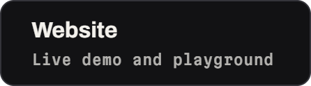
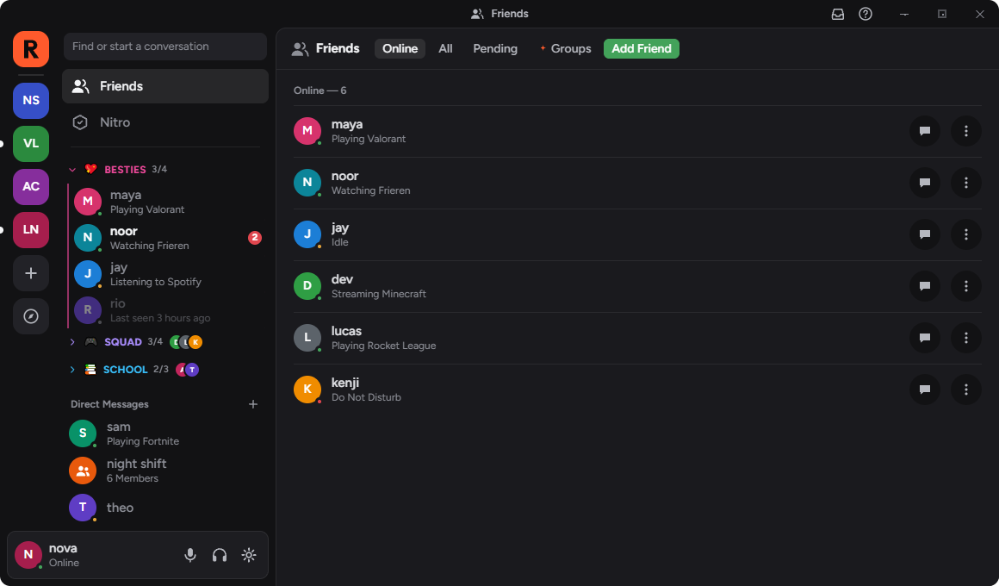
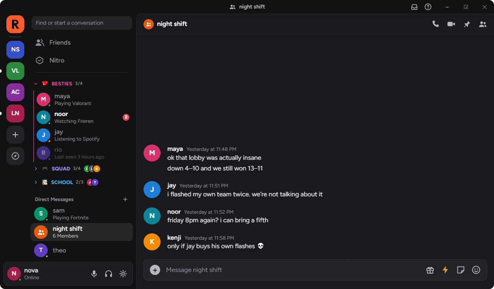
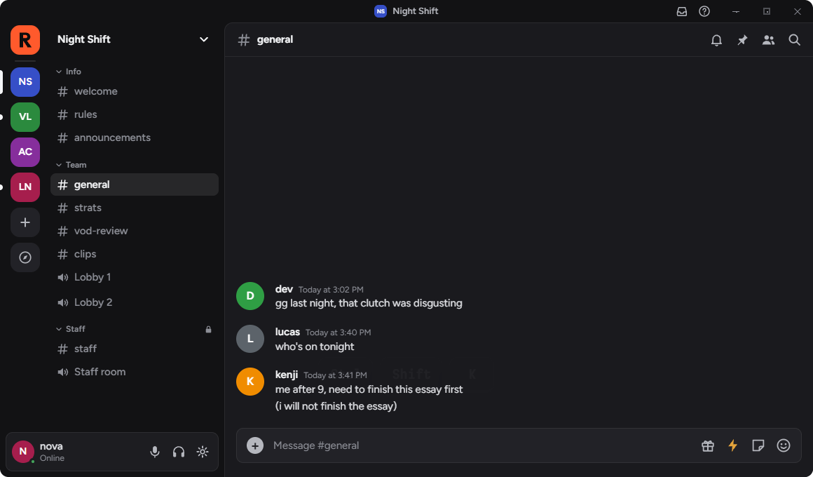
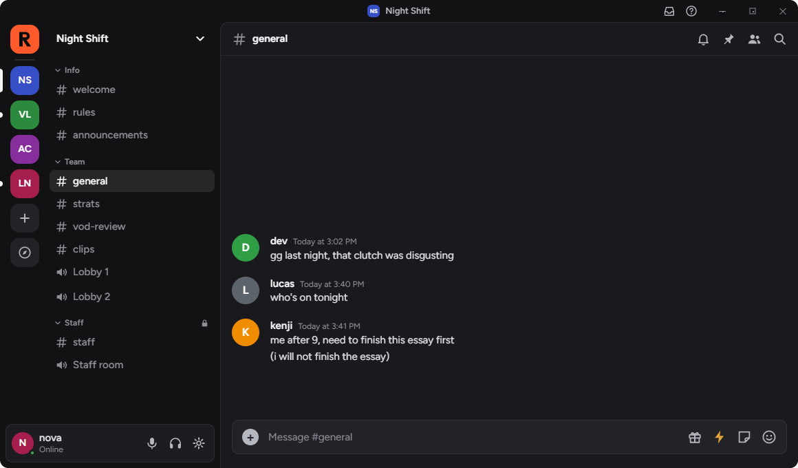
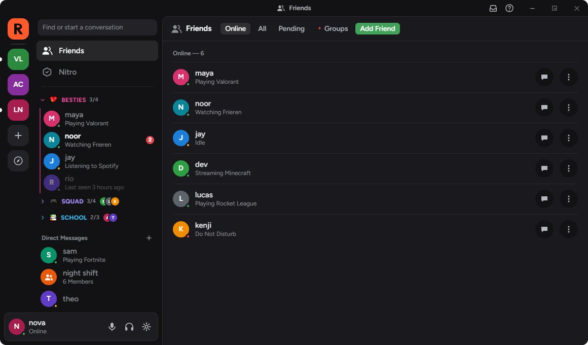

<div align="center">

<a href="https://renuxchan.github.io/Renuxcord/"></a>

<br>
<br>

<a href="https://renuxchan.github.io/Renuxcord/#download"></a>
&nbsp;
<a href="https://renuxchan.github.io/Renuxcord/"></a>
&nbsp;
<a href="https://renuxchan.github.io/Renuxcord/#plugins"></a>

<br>
<br>

<a href="https://github.com/Renuxchan/Renuxcord/actions/workflows/renuxcord-release.yml"></a>
<a href="https://github.com/Renuxchan/Renuxcord/commits/main"></a>
<a href="https://renuxchan.github.io/Renuxcord/#plugins"></a>
<a href="#the-45-exclusives"></a>
<a href="#install"></a>
<a href="../LICENSE"></a>

<br>
<br>

**Renuxcord is a free client mod for Discord on Windows, macOS, Linux, Android and iPhone.**<br>
218 plugins, 45 you won't find anywhere else, and it keeps itself up to date.

</div>

<br>

## The tour

Six things Renuxcord adds to Discord, playing for real. There's a live version you can click through, and a playground that runs a few plugins in your browser, on the **[website](https://renuxchan.github.io/Renuxcord/)**.

### Friend Groups

Your friends in folders, right in the DM list. Every folder gets an emoji, a colour and an online count, folds away when you don't need it, and takes people by drag and drop. Click anyone to open your DM.



### RenuxAI

Claude in your chat. `/ai catchup` reads everything you missed and sums it up, only for you. Right-click any message to get it explained, translated or answered, or point it at an image to describe it or pull the text out. It runs on your Claude Code login, so there's no API key to buy.



### Command palette

<kbd>Ctrl</kbd> <kbd>Shift</kbd> <kbd>K</kbd>, a few letters, <kbd>Enter</kbd>. Switch any plugin on or off, change plugin profiles, or jump to a server, channel or DM without touching settings.



### LinkSafety and SecretGuard

LinkSafety puts a warning under look-alike Discord, Steam and Roblox links before anyone clicks them. SecretGuard stops you before your token, a Roblox cookie, an API key or a card number goes out. Nothing gets blocked, it just asks first.



### Voice Chat Unblocker

Where Discord voice is blocked, like in the UAE, text works but calls never connect. VoiceChatUnblocker sends voice through a tiny relay inside Renuxcord that starts every connection with decoy packets, and switches tricks by itself until one gets through. No VPN.


### Server builder

RenuxBridge hooks Discord up to Claude Code over MCP. Describe the server you want and it gets built: roles in the right order, private categories, voice lobbies, permissions and all.



<details>
<summary><b>Set up RenuxBridge</b></summary>
<br>

1. Turn on **RenuxBridge** in Settings › Renuxcord › Plugins.
2. Press **Copy command** in its settings and run it once in a terminal. It looks like this:

   ```sh
   claude mcp add renuxcord --scope user -- node "%APPDATA%\Renuxcord\dist\renuxcord-mcp.mjs"
   ```

3. Start Claude Code and ask for what you want:
   - "make me a server called Night Shift for my valorant team: roles for coach, players and subs, a private staff area, voice lobbies and a rules channel"
   - "give the Mod role timeout and manage messages, then lock #announcements so only Mods can post"
   - "export the layout of my main server and clone it into a new one"
   - `/mcp__renuxcord__build_server` and `/mcp__renuxcord__audit_server` are ready-made prompts

The bridge only listens on `127.0.0.1` behind a random token, rejects web pages, works at a human pace and never touches DMs. Deleting stays off until you switch on **Allow deleting** in its settings.

</details>

## Install

| | Get it | Then |
| --- | --- | --- |
| **Windows** | **[RenuxcordInstaller.exe](https://github.com/Renuxchan/Renuxcord/releases/latest/download/RenuxcordInstaller.exe)** | Run it, pick your Discord, press **Install / Repair** |
| **macOS** | **[RenuxcordInstaller-mac.zip](https://github.com/Renuxchan/Renuxcord/releases/latest/download/RenuxcordInstaller-mac.zip)** | Open the app, pick your Discord, press **Install / Repair** |
| **Linux** | **[.deb](https://github.com/Renuxchan/Renuxcord/releases/latest/download/RenuxcordInstaller-linux-x64.deb)** · **[.rpm](https://github.com/Renuxchan/Renuxcord/releases/latest/download/RenuxcordInstaller-linux-x64.rpm)** · **[.tar.gz](https://github.com/Renuxchan/Renuxcord/releases/latest/download/RenuxcordInstaller-linux-x64.tar.gz)** | Start **Renuxcord Installer** from your apps |
| **Android** | **[Renuxcord.apk](https://github.com/Renuxchan/Renuxcord/releases/latest/download/Renuxcord.apk)** | Install it and log in to Discord |
| **iPhone and iPad** | **[Add to SideStore, AltStore or TrollStore](https://renuxchan.github.io/Renuxcord/#download)** | Open that link on your iPhone and tap your sideloading app |

After that Renuxcord updates itself, and puts itself back after Discord updates.

<details>
<summary><b>Windows, step by step</b></summary>
<br>

1. Download **[RenuxcordInstaller.exe](https://github.com/Renuxchan/Renuxcord/releases/latest/download/RenuxcordInstaller.exe)**. It's tiny because it downloads the newest build when it runs.
2. The installer isn't code-signed yet, so Windows may say it protected your PC. Click **More info › Run anyway**.
3. Pick your Discord (Stable, PTB or Canary) and press **Install / Repair**. Discord restarts with Renuxcord.
4. Switch plugins on in **Settings › Renuxcord › Plugins**, or turn on CommandPalette and press <kbd>Ctrl</kbd> <kbd>Shift</kbd> <kbd>K</kbd>.

Uninstall the same way. Your settings stay in `%APPDATA%\Renuxcord`.

</details>

<details>
<summary><b>macOS and Linux, step by step</b></summary>
<br>

1. Download the installer: **[macOS](https://github.com/Renuxchan/Renuxcord/releases/latest/download/RenuxcordInstaller-mac.zip)** (Apple silicon and Intel), **[Linux .deb](https://github.com/Renuxchan/Renuxcord/releases/latest/download/RenuxcordInstaller-linux-x64.deb)** (Ubuntu, Debian, Mint), **[Linux .rpm](https://github.com/Renuxchan/Renuxcord/releases/latest/download/RenuxcordInstaller-linux-x64.rpm)** (Fedora, openSUSE) or the **[Linux .tar.gz](https://github.com/Renuxchan/Renuxcord/releases/latest/download/RenuxcordInstaller-linux-x64.tar.gz)** (anything else).
2. **Mac:** open the zip and run **Renuxcord Installer**. It isn't notarized, so macOS blocks it the first time: open **System Settings › Privacy & Security** and press **Open Anyway**. **Linux:** open the .deb or .rpm to install it like any app, then start **Renuxcord Installer** from your apps (with the .tar.gz: extract it and double-click RenuxcordInstaller).
3. Pick your Discord and press **Install / Repair**. Discord restarts with Renuxcord.

If macOS says it blocked changes to Discord, turn the installer on in **System Settings › Privacy & Security › App Management** and press Install again. Settings live in `~/Library/Application Support/Renuxcord` on macOS and `~/.config/Renuxcord` on Linux.

Rather use a terminal? This does the same (works with the normal download, .deb, .rpm, tar.gz and Flatpak, not Snap):

```sh
curl -fsSL https://github.com/Renuxchan/Renuxcord/releases/download/devbuild/install.sh | sh
```

`... | sh -s -- uninstall` takes it out again and `status` shows what it found. On a Mac, run it again after Discord itself updates.

</details>

<details>
<summary><b>Android and iPhone, step by step</b></summary>
<br>

**Android:** install **[Renuxcord.apk](https://github.com/Renuxchan/Renuxcord/releases/latest/download/Renuxcord.apk)** (Android 8 or newer) and allow installing from your browser when Android asks. It opens Discord with Renuxcord loaded, keeps Renuxcord updated, and adds a **Renuxcord app** page to Discord's settings. Notifications, voice, camera and downloads all work. More in [mobile/android](../mobile/android).

**iPhone and iPad:** open the **[website](https://renuxchan.github.io/Renuxcord/#download)** on your iPhone and tap **Add to SideStore**, **Add to AltStore** or **Install with TrollStore**. SideStore and AltStore add the Renuxcord source (`https://github.com/Renuxchan/Renuxcord/releases/latest/download/altstore.json`) and keep the app updated. Using Sideloadly or something else? Get **[Renuxcord.ipa](https://github.com/Renuxchan/Renuxcord/releases/latest/download/Renuxcord.ipa)**. No sideloading at all? Install the free **Userscripts** app from the App Store, add **[Renuxcord.user.js](https://github.com/Renuxchan/Renuxcord/releases/latest/download/Renuxcord.user.js)** and open discord.com in Safari. More in [mobile/ios](../mobile/ios).

The phone apps run Discord's full web app with Renuxcord in it, in a phone layout: voice and video calls, Server Discovery, and every menu (hold anything to open its menu). Swipe or press back to get from a chat to your servers. On Android, message notifications keep coming in the background (turn that off in the app's settings). Only the plugins that need a computer (the AI bridge, files on your PC, Voice Chat Unblocker) stay on desktop.

</details>

## The 45 exclusives

Every one carries the **✦ RENUXCORD EXCLUSIVE** badge in Settings › Renuxcord › Plugins, sorted to the top. The 170+ classic plugins are all there too, and after an update you get a one-time list of the newest exclusives to switch on. The **[website](https://renuxchan.github.io/Renuxcord/#exclusives)** has the details for each one.

<details>
<summary><b>AI and server building</b> · RenuxAI, RenuxBridge, ServerBlueprints, CustomPlugins</summary>
<br>

| Plugin | What it does |
| --- | --- |
| **RenuxAI** | Claude inside Discord: `/ai ask`, `/ai catchup` (unread messages), `/ai summarize`, `/ai rewrite`, `/ai translate`, right-click any message to explain it or get a reply suggestion, and describe or read the text in images. Uses your Claude Code login, or an Anthropic API key if you prefer |
| **RenuxBridge** | AI bridge for Claude Code (MCP). Say "make me a gaming server with roles and private staff channels" and it happens in Discord |
| **ServerBlueprints** | Copy a server's roles, channels and permissions as JSON, paste blueprints into your servers, or clone a server's layout in one click |
| **CustomPlugins** | Loads your own `.js` plugins from `%APPDATA%\Renuxcord\plugins` (see below) |

</details>

<details>
<summary><b>Chat tools</b> · QuickTools, TextFX, QuickReplies, Lookup, WhoIs, Snipe and 6 more</summary>
<br>

| Plugin | What it does |
| --- | --- |
| **QuickTools** | `/calc`, `/roll 2d20+5`, `/flip`, `/choose`, `/random`, `/8ball`, `/timestamp` (Discord time tags), `/encode` (base64, hex, binary, morse…), `/hash` and `/password` |
| **TextFX** | `/fx` fancy text: 𝗯𝗼𝗹𝗱, 𝓼𝓬𝓻𝓲𝓹𝓽, 𝖌𝖔𝖙𝖍𝖎𝖈, ｖａｐｏｒｗａｖｅ, ᴛɪɴʏ ᴄᴀᴘs, uʍop ǝpısdn, z̷a̷l̷g̷o̷, mOcKiNg, 👏 clap 👏, owo and more |
| **QuickReplies** | A ⚡ button in the message box with your saved replies and a kaomoji library |
| **Lookup** | `/weather`, `/define`, `/urban` and `/wiki` without leaving Discord |
| **WhoIs** | `/whois @someone`: account age, join date, roles, games, mutual servers and friends, local time, last seen, birthday |
| **Snipe** | `/snipe` the last deleted messages in a channel and `/editsnipe` what an edited message said before |
| **Bookmarks** | Save messages and find them again in a searchable list with jump-to-message |
| **MessageScheduler** | `/schedule 2h30m hey` or `/schedule 9pm ...` to send messages later |
| **MessageReminders** | Right-click a message → Remind me in 15m / 1h / tomorrow / any time, with a notification that jumps back to it |
| **ChatExporter** | Save a whole chat, every message, as a styled HTML page, text or JSON (`/export` or right-click a channel). Big chats take a few minutes, and you can stop it part way |
| **MediaDownloader** | Save every image, video and file from a message or a whole channel into Downloads › Renuxcord |
| **Notepad** | Notes inside Discord: `Ctrl+Alt+N`, `/notes`, `/note`, and right-click → Save to Notepad |

</details>

<details>
<summary><b>Alerts and safety</b> · GhostPingAlert, KeywordAlerts, LinkSafety, SecretGuard and 3 more</summary>
<br>

| Plugin | What it does |
| --- | --- |
| **GhostPingAlert** | Tells you who pinged you and what they said when they delete it or edit the ping out |
| **KeywordAlerts** | Notifications for your own keywords or regexes anywhere you are |
| **MentionSound** | Custom ping sounds (built-in synth sounds or your own file) |
| **ChannelWatch** | Right-click a channel → Watch to get a notification for every message, even in muted servers |
| **LinkSafety** | Warns under messages with scam links: fake Discord/Steam/Roblox domains, look-alike characters, raw IPs, masked link tricks, free-nitro bait |
| **SecretGuard** | Asks before you send a Discord token, Roblox cookie, API key, private key, password or card number |
| **SpoilerShield** | Blurs messages that mention words you pick until you hover them |

</details>

<details>
<summary><b>Friends</b> · FriendGroups, FriendWatch, FriendTimes, LastSeen, BirthdayReminders</summary>
<br>

| Plugin | What it does |
| --- | --- |
| **FriendGroups** | Friend folders with emoji icons and colours, right in your DM sidebar: minimize them, drag friends between them, click anyone to open your DM, see who's online and what they're playing. Also a Groups tab on the Friends page |
| **FriendWatch** | Get notified when people you pick come online or start a game |
| **FriendTimes** | Set friends' time zones once and see their local time in chat, in Friend Groups and with `/time` |
| **LastSeen** | See when friends were last online: right-click, Friend Groups, `/whois` and `/lastseen` |
| **BirthdayReminders** | Save friends' birthdays and get a notification on the day (and the day before), `/birthdays` |

</details>

<details>
<summary><b>Voice and status</b> · VoiceChatUnblocker, Drover, FakeDeafen, VoiceLog, FocusMode, StatusRotator, PanicBlur</summary>
<br>

| Plugin | What it does |
| --- | --- |
| **VoiceChatUnblocker** | Renuxcord's own voice chat unblocker for networks that block Discord voice (like the UAE). Voice goes through a tiny relay inside Renuxcord that starts every connection with decoy packets, so the network can't tell it's Discord voice, and switches tricks by itself until one gets through. Windows, macOS and Linux, no DLLs |
| **Drover** | The other way to unblock voice: gets Discord voice working where it's blocked (like the UAE) and can send Discord through an HTTP or SOCKS5 proxy. Sets up [hdrover's Discord Drover](https://github.com/hdrover/discord-drover) for you on Windows: it downloads the official release and checks it before installing |
| **FakeDeafen** | Look deafened to everyone in the call while you can still hear (`Ctrl+Alt+D`) |
| **VoiceLog** | Timestamped log of who joined and left your voice channel |
| **FocusMode** | `Ctrl+Alt+F`: Do Not Disturb, hides the server and member lists, Pomodoro timer, automatic quiet hours |
| **StatusRotator** | Cycles your custom status through a list with live tokens like `{time}`, `{game}` and `{online}` |
| **PanicBlur** | `Ctrl+Alt+B` blurs all of Discord instantly, optionally whenever it loses focus |

</details>

<details>
<summary><b>Look and feel</b> · RenuxTheme, CSSSnippets, TypingSounds, Confetti, RenuxBadges</summary>
<br>

| Plugin | What it does |
| --- | --- |
| **RenuxTheme** | Theme engine: colour presets, custom accent, background image with blur/dim/glass, rounder corners, any Google Font. Live preview |
| **CSSSnippets** | One-click tweaks: hide Nitro and Shop upsells, gift, sticker and app buttons, Active Now, decorations, nameplates, server tags, call buttons |
| **TypingSounds** | Keyboard sounds while you type: thocky mechanical, clicky, typewriter with the ding, bubble pops, retro 8-bit |
| **Confetti** | 🎉 Confetti cannons when someone says congrats or happy birthday, or with `/confetti` |
| **RenuxBadges** | Always on: everyone using Renuxcord gets a Renuxcord User badge that other Renuxcord users see. It works through an invisible tag Renuxcord adds to the end of your About Me. Plus badges for the owner, devs and friends of the project |

</details>

<details>
<summary><b>Stats and control</b> · CommandPalette, PluginProfiles, SessionStats, PlaytimeTracker, RenuxcordWelcome</summary>
<br>

| Plugin | What it does |
| --- | --- |
| **CommandPalette** | `Ctrl+Shift+K`: toggle any plugin, switch profiles, run toolbox actions, open settings, jump to servers, channels and DMs |
| **PluginProfiles** | Save sets of enabled plugins (Gaming, Minimal, Streaming) and switch in one click, plus safe mode |
| **SessionStats** | Your own stats: messages, pings, time online and in voice (`/stats`) |
| **PlaytimeTracker** | How long you play each game today, this week, this month and all time (`/playtime`), with break reminders |
| **RenuxcordWelcome** | The welcome screen, the one-time "New in Renuxcord" list when new plugins land, and `/renuxcord` |

</details>

## Write your own plugins

Every `.js` file in `%APPDATA%\Renuxcord\plugins` loads before Discord does, so it can do everything a built-in plugin can: patches, slash commands, context menus, settings, flux events. The folder is created with a README and a working example (`HelloRenuxcord.js`). Open it from Settings › Renuxcord › **Custom Plugins**, reload Discord, then switch your plugin on in the plugin list (it has a 🧩 CUSTOM badge).

```js
const { definePlugin, CommandOptionType } = Renuxcord;

module.exports = definePlugin({
    name: "Hello",
    description: "Adds /hello",
    commands: [{
        name: "hello",
        description: "Say hi",
        execute(args, ctx) {
            Renuxcord.Api.Commands.sendBotMessage(ctx.channel.id, { content: "Hello! 👋" });
        }
    }]
});
```

`Renuxcord` gives you `definePlugin`, `definePluginSettings`, `OptionType`, `CommandOptionType`, `StartAt`, `Common` (Discord stores, React, Menu, RestAPI…), `Webpack`, `Api`, `Util`, `Components`, `showToast` and `notify`. Only add plugins you trust: they run with full access to your account.

## FAQ

<details>
<summary><b>Is it free? What's the catch?</b></summary>
<br>

Free, no account, no ads, no catch. The whole thing is open source under GPL-3.0, so anyone can read exactly what it does.

</details>

<details>
<summary><b>Windows says "Windows protected your PC"</b></summary>
<br>

The installer isn't code-signed yet, so SmartScreen doesn't recognise it. Click **More info › Run anyway**. It's built from this repository by GitHub's own build machines.

</details>

<details>
<summary><b>Discord voice doesn't work where I live</b></summary>
<br>

In places like the UAE, Discord's text works but voice calls get blocked. Turn on **VoiceChatUnblocker** on Windows, macOS or Linux. Renuxcord sends voice through a tiny relay that starts every connection with decoy packets, so the network can't tell it's Discord voice, and it switches tricks by itself until one gets through. No VPN.

</details>

<details>
<summary><b>What's the Renuxcord badge, and why is there a tag in my About Me?</b></summary>
<br>

Everyone using Renuxcord gets a Renuxcord User badge on their profile, and Renuxcord users see each other's. It works through an invisible tag Renuxcord adds to the end of your About Me. People without Renuxcord can't see the tag, and the badge is always on.

</details>

<details>
<summary><b>Will Discord updates break it?</b></summary>
<br>

Renuxcord puts itself back after Discord updates. Fixes for Discord's changes get merged in every 6 hours, built, and delivered by the updater, which checks every 10 minutes.

</details>

<details>
<summary><b>Is it allowed?</b></summary>
<br>

Client mods are against Discord's Terms of Service. Lots of people use them anyway, but it's at your own risk.

</details>

<details>
<summary><b>Build from source</b></summary>
<br>

```sh
pnpm install
pnpm install --dir mcp --ignore-workspace
pnpm build --standalone
node scripts/renuxcord/buildMcp.mjs
node scripts/renuxcord/install.mjs install   # copies dist/ to %APPDATA%\Renuxcord and patches Discord
node scripts/renuxcord/install.mjs status
node scripts/renuxcord/install.mjs uninstall
```

The Windows installer builds with the C# compiler that ships with Windows: `powershell -ExecutionPolicy Bypass -File installer/build.ps1`. The macOS and Linux installer is a Go app in [`installer/desktop`](../installer/desktop): `sh installer/desktop/build.sh` on a Mac or a Linux box.

The phone apps live in [`mobile/android`](../mobile/android) (Gradle) and [`mobile/ios`](../mobile/ios) (XcodeGen). The **Renuxcord Mobile** workflow builds both, checks Renuxcord loads in an Android emulator and an iOS simulator, and adds Renuxcord.apk and Renuxcord.ipa to the release.

The website is plain HTML, CSS and JavaScript in [`site`](../site). Preview it with any static server, for example `python -m http.server --directory site`, after `pnpm generatePluginJson site/plugins.json site/plugin-readmes.json`. The **Renuxcord Site** workflow publishes it on every push.

**Updates:** Renuxcord updates itself from this repository's `devbuild` release (Settings › Renuxcord › Updater, auto-update is on by default). A workflow merges the upstream project every 6 hours, checks that it builds and publishes a new release.

**Maintainer notes**

- Renuxcord's code lives in new files wherever possible (`src/plugins/<renuxcord plugins>`, `src/utils/renuxcord*.ts`, `mcp/`, `installer/`, `scripts/renuxcord/`) and branding changes are small edits, so upstream merges rarely conflict.
- If upstream changes `.github/workflows`, the sync job can only push them with a token that has the `workflow` scope. Add a fine-grained token as the `SYNC_TOKEN` repository secret.
- Add badge holders to [`badges.json`](../badges.json) by Discord user ID.
- The README art in `.github/assets` is rendered from the website: the banner and buttons from its styles, the tour clips by recording the site's live demo.

</details>

## License

GPL-3.0-or-later, see [LICENSE](../LICENSE). Renuxcord is a modified version of Vencord by Vendicated and contributors; their copyright notices are kept in the source as the license requires. Client mods are against Discord's Terms of Service, use at your own risk.

<div align="center">
<br>
<a href="https://renuxchan.github.io/Renuxcord/#download"></a>
&nbsp;
<a href="https://renuxchan.github.io/Renuxcord/"></a>
</div>
